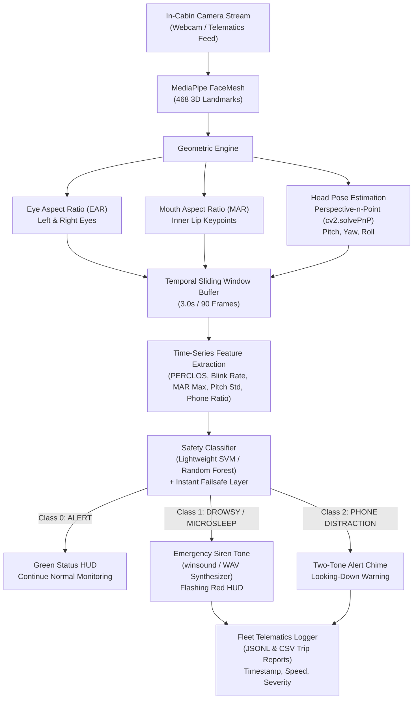

# Project 119: Driver Fatigue & Distraction Safety Monitor

**Domain:** Computer Vision, Machine Learning, Automotive Safety, Telematics  
**Objective:** Detect driver fatigue, microsleep, and mobile-phone distraction in real time using facial landmarks to reduce commercial highway collisions.

---

## 1. System Architecture



---

## 2. Mathematical Formulations

### 2.1 Eye Aspect Ratio (EAR)
Defined by Soukupov&aacute; & Cech (2016) using 6 landmark coordinates per eye:
$$EAR = \frac{||p_2 - p_6|| + ||p_3 - p_5||}{2 \cdot ||p_1 - p_4||}$$
- **Alert Range:** $0.28 \le EAR \le 0.38$
- **Closed Eyelids:** $EAR < 0.22$
- **Microsleep Detection:** Consecutive closed frames $> 40$ ($\approx 1.3\text{ seconds}$).

### 2.2 Percentage of Eye Closure (PERCLOS)
Automotive gold standard for drowsiness evaluation:
$$PERCLOS = \frac{\sum_{t \in W} \mathbb{I}(EAR_t < 0.22)}{|W|} \times 100\%$$
- When $PERCLOS > 35\%$, drowsiness alarm is engaged.

### 2.3 Mouth Aspect Ratio (MAR)
Detects sustained yawning apertures:
$$MAR = \frac{||p_{81} - p_{178}|| + ||p_{13} - p_{14}|| + ||p_{311} - p_{402}||}{3 \cdot ||p_{78} - p_{308}||}$$
- **Threshold:** $MAR > 0.65$ sustained for $> 35$ frames.

### 2.4 Head Pose Estimation (Perspective-n-Point)
Using 3D Anthropometric model points (nose, chin, eyes, mouth corners) and 2D camera projections:
$$\begin{bmatrix} u \\ v \\ 1 \end{bmatrix} = K \cdot [R \mid T] \begin{bmatrix} X_w \\ Y_w \\ Z_w \\ 1 \end{bmatrix}$$
- Decomposed via `cv2.RQDecomp3x3` into Euler angles ($\theta_{pitch}, \theta_{yaw}, \theta_{roll}$).
- **Mobile Phone Signature:** Pitch $< -14.0^\circ$ (prolonged downward gaze into lap/console) coupled with forward gaze departure.

---

## 3. Directory Structure

```
driver_fatigue_safety_monitor/
├── config/
│   └── settings.py          # Thresholds, FPS, temporal window, camera settings
├── core/
│   ├── facial_landmarks.py  # MediaPipe 468 FaceMesh wrapper
│   ├── geometry_features.py # EAR, MAR, solvePnP Head Pose, and biometrics
│   └── temporal_buffer.py   # Rolling 3s statistical aggregator
├── ml/
│   ├── model_trainer.py     # SVM/Random Forest training & synthetic telematics generator
│   └── classifier.py        # Real-time inference engine with safety failsafes
├── audio/
│   ├── alert_manager.py     # Multi-tier async sound synthesizer (winsound/pygame)
│   └── sounds/              # Auto-synthesized pure-tone safety alarm WAVs
├── telematics/
│   └── event_logger.py      # Structured JSONL and CSV fleet compliance logger
├── ui/
│   └── hud_overlay.py       # Heads-Up Display with live gauge meters & wireframe
├── main.py                  # Primary application entry point (Webcam & Sim)
├── evaluate.py              # Precision, Recall, Confusion Matrix & Latency test
├── requirements.txt         # Package dependencies
└── README.md                # Project documentation
```

---

## 4. How to Run

### Step 1: Install Dependencies
```bash
pip install -r requirements.txt
```

### Step 2: Run with Interactive Simulator (No Webcam Needed)
The project comes with a built-in avatar simulator so you can test and demonstrate all alerts without needing a camera:
```bash
python main.py --source mock
```
**Interactive Simulator Hotkeys:**
- Press `1`: Normal Alert Driving
- Press `2`: Trigger Microsleep (Eyes closed, sagging head $\to$ Immediate Siren)
- Press `3`: Trigger Mobile Phone Distraction (Head pitched into lap $\to$ Chime)
- Press `4`: Trigger Yawning (Elevated MAR)
- Press `M`: Toggle audio mute
- Press `D`: Toggle landmark wireframe overlay
- Press `S`: Save high-resolution telemetry snapshot
- Press `Q`: Quit application

### Step 3: Run with Physical In-Cabin Webcam
```bash
python main.py --source 0
```

### Step 4: Run with Video File
```bash
python main.py --source path/to/driver_video.mp4
```

### Step 5: Run Offline Model Evaluation & Latency Benchmarks
```bash
python evaluate.py
```
Outputs classification report, high recall checks ($>95\%$ for microsleep), and inference latency statistics ($< 1.0\text{ ms}$ per decision cycle).

---

## 5. Kaggle Dataset Integration

1. **State Farm Distracted Driver Detection (`kaggle.com/c/state-farm-distracted-driver-detection`)**:
   - Classes `c1` (texting - right), `c2` (talking on phone - right), `c3` (texting - left), `c4` (talking on phone - left) map directly to Class 2 (`DISTRACTED / PHONE`).
2. **NTHU Driver Drowsiness Dataset**:
   - Use infrared cabin videos to evaluate EAR under nighttime lighting conditions.
